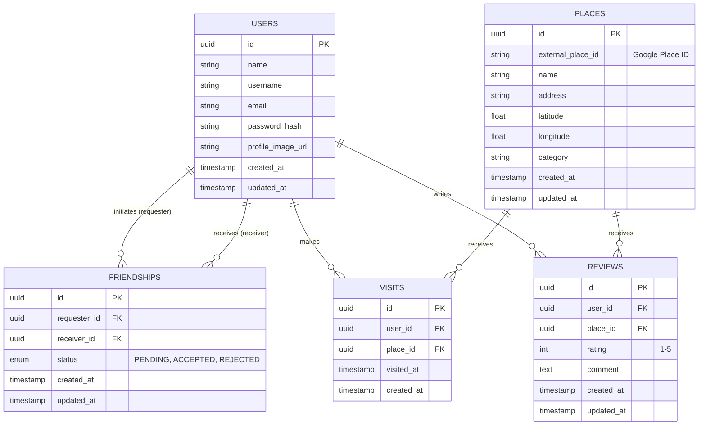

# FriendPlace - Implementation Plan and Architecture

## 1 & 2 & 3. Workspace Inspection
The workspace is currently empty except for an initial `PROJECT_V1.md` file. No existing code or project structure is present, so it is safe to proceed with the proposed initial structure. The existing `PROJECT_V1.md` has been moved to the `docs/` folder to keep the root directory clean.

## 4 & 9. Proposed Folder Structure
```text
FriendPlace/
├── backend/
│   ├── src/
│   │   ├── config/          # Environment variables, database connection
│   │   ├── controllers/     # Route handlers (req, res)
│   │   ├── services/        # Business logic (users, friends, places)
│   │   ├── repositories/    # Database queries and operations
│   │   ├── routes/          # Express route definitions
│   │   ├── middleware/      # Auth, error handling, validation
│   │   ├── schemas/         # Zod schemas for input validation
│   │   ├── utils/           # Helper functions (hashing, etc.)
│   │   ├── types/           # TypeScript interfaces/types
│   │   ├── app.ts           # Express app setup
│   │   └── server.ts        # Entry point, starts the server
│   ├── package.json
│   ├── tsconfig.json
│   └── Dockerfile
├── frontend/
│   ├── src/
│   │   ├── assets/          # Static files (images, icons)
│   │   ├── components/      # Reusable UI components (Navbar, Button, etc.)
│   │   ├── hooks/           # Custom React hooks (e.g., useAuth, usePlaces)
│   │   ├── layouts/         # Page layouts (e.g., MainLayout with Navbar)
│   │   ├── lib/             # Third-party library configurations (axios, queryClient)
│   │   ├── pages/           # Route components (Home, Login, PlaceDetails)
│   │   ├── services/        # API calls to backend
│   │   ├── types/           # TypeScript interfaces for frontend state
│   │   ├── utils/           # Helper functions
│   │   ├── App.tsx          # Main React component, Routing
│   │   └── main.tsx         # React DOM render entry
│   ├── index.html
│   ├── package.json
│   ├── tsconfig.json
│   ├── vite.config.ts
│   └── tailwind.config.js
├── docs/                    # Project documentation (architecture, API, plans)
├── .env.example             # Example environment variables
├── .gitignore               # Git ignore rules
├── docker-compose.yml       # Docker compose for DB and optional backend
└── README.md                # Main project overview
```

## 5. Detailed Implementation Plan
- **PHASE 0: Project setup** - Initialize frontend (Vite/React) and backend (Node/Express). Set up TypeScript, ESLint, Prettier.
- **PHASE 1: Database** - Set up PostgreSQL via Docker Compose, create initial schema/migrations using a query builder or raw SQL.
- **PHASE 2: Backend foundation** - Setup Express, error handling, logging, basic folder structure (controllers, services, repositories).
- **PHASE 3: Authentication** - Implement Argon2 hashing, session-based HTTP-only cookies, `/register`, `/login`, `/me` endpoints.
- **PHASE 4: Users + Friends** - Implement user search, send/accept/reject friend requests.
- **PHASE 5: Places API** - Integrate Google Places API in the backend (search, details) and normalize responses.
- **PHASE 6: Visits** - Implement "I've Been Here" logic, store visits in DB.
- **PHASE 7: Reviews** - Implement review creation, editing, deleting, and validation (1-5 stars, only own reviews).
- **PHASE 8: Friend recommendation layer** - Calculate friend counts, average ratings, basic deterministic ranking based on V1 rules.
- **PHASE 9: Frontend integration and polish** - Build UI components (Tailwind), connect with React Query, apply design rules (modern, clean, minimal).
- **PHASE 10: Testing and security** - Write tests (Vitest/Supertest for backend, RTL for frontend), add rate-limiting, CORS, Helmet.
- **PHASE 11: Docker and deployment** - Finalize `docker-compose.yml`, write Dockerfiles, test production builds locally.
- **PHASE 12: Final documentation** - Update README and API docs.

## 6. Architecture Decisions Needing Clarification
1. **Session Management:** We need secure authentication. We can use JWTs inside HTTP-only cookies, or a stateful session store (e.g., `express-session` with a PostgreSQL store). **Recommendation:** JWT inside HTTP-only cookies is stateless and fits this stack well for V1.
2. **Database Access:** Will we use an ORM (Prisma/TypeORM), a Query Builder (Kysely/Knex), or raw SQL (`pg` module)? **Recommendation:** Kysely for strict type-safety without the heavy footprint of an ORM.
3. **Database Migrations:** How do we manage schema changes? **Recommendation:** If Kysely is chosen, we will write migrations in TypeScript and use Kysely's migrator.

## 7. Required Environment Variables
**Backend (.env):**
- `PORT` (e.g., 5000)
- `NODE_ENV` (development | production)
- `DATABASE_URL` (PostgreSQL connection string)
- `JWT_SECRET` (For signing cookies)
- `GOOGLE_PLACES_API_KEY` (For external places data)
- `FRONTEND_URL` (For CORS, e.g., http://localhost:5173)

**Frontend (.env):**
- `VITE_API_URL` (e.g., http://localhost:5000/api)

## 8. Exact Packages Needed for Phase 0
**Backend:**
- **Dependencies:** `express`, `cors`, `dotenv`, `zod`, `cookie-parser`
- **Dev Dependencies:** `typescript`, `@types/node`, `@types/express`, `@types/cors`, `@types/cookie-parser`, `tsx` (for fast execution), `eslint`, `prettier`

**Frontend:**
- **Dependencies:** `react`, `react-dom`, `react-router-dom`, `@tanstack/react-query`, `lucide-react` (for icons)
- **Dev Dependencies:** `vite`, `typescript`, `tailwindcss`, `postcss`, `autoprefixer`, `eslint`, `prettier`, `@types/react`, `@types/react-dom`

## 9. Initial Database ER Relationship


## 10. First 5 Git Commits Expected
1. `chore: initialize empty project structure and documentation`
2. `chore: setup React/Vite frontend with Tailwind and routing`
3. `chore: setup Node/Express backend with TypeScript and ESLint`
4. `chore: setup Docker Compose with PostgreSQL database`
5. `feat: add initial database schema migrations for users and friendships`
